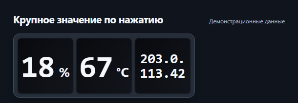
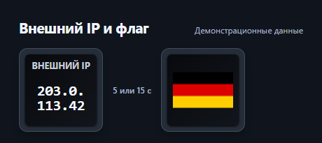
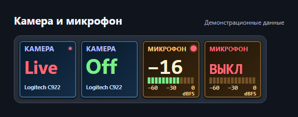
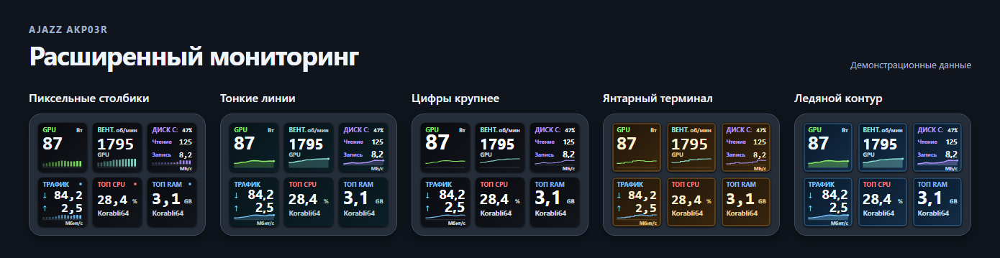
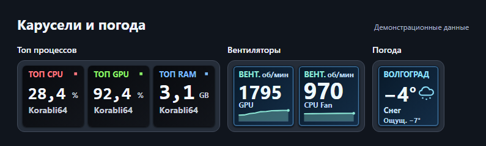

# AJAZZ — ТТХ GPU/CPU/RAM/IP

Кнопка **Download** скачивает полный установщик Windows. Мониторинг ПК, игровые кнопки, управление звуком и камерой, погода и запуск Bitwarden доступны в одной категории из двадцати действий. Для виджетов есть пять тем.

- **Обновление кнопок.** Открой файл, подтверди обновление и полностью перезапусти Stream Dock. [Скачать обновление (.sdPlugin)](https://github.com/Auskraft/ajazz-ttx-gpu-cpu-ram-ip/releases/latest/download/com.auskraft.ajazz.ttx.sdPlugin)
- **Захват FPS и вентиляторы платы.** Запусти полный установщик и выбери **«Да»**, чтобы поставить или обновить фоновые компоненты вместе с плагином. [Скачать установщик Windows (.exe)](https://github.com/Auskraft/ajazz-ttx-gpu-cpu-ram-ip/releases/latest/download/AJAZZ-TTX-Setup.exe)

## Установка

1. Установи **Stream Dock AJAZZ Global** версии **3.10.188.226** или новее и запусти программу хотя бы один раз. Нужна 64-битная Windows 10 или 11. Для показаний NVIDIA нужен штатный драйвер с `nvidia-smi`.
2. Скачай и запусти **AJAZZ-TTX-Setup.exe** из [последнего релиза](https://github.com/Auskraft/ajazz-ttx-gpu-cpu-ram-ip/releases/latest). Выбери **«Да»** и подтверди запрос Windows, чтобы добавить датчик CPU и вентиляторов платы и захват FPS по запросу. Установщик добавит подписанный драйвер PawnIO, если его ещё нет. Если выбрать **«Нет»**, обновится только плагин. AIDA64 не требуется.
3. Подтверди импорт в Stream Dock. Если категория уже импортирована, но её нет в списке, полностью закрой Stream Dock через область уведомлений и запусти снова.
4. Открой категорию **«ТТХ GPU/CPU/RAM/IP»** и перетащи действия в нужные ячейки.

Для ручной установки плагина из релиза открой `com.auskraft.ajazz.ttx.sdPlugin`. Для температуры CPU и вентиляторов платы нужен фоновый датчик из установщика.

## Настройки кнопок

| Верхний ряд | Температура CPU | Температура GPU | Оперативная память |
| --- | --- | --- | --- |
| **Нижний ряд** | Загрузка CPU | Загрузка GPU | IP-адрес |

- У виджетов можно выбрать **«Пиксельные столбики»**, **«Тонкие линии»**, **«Цифры крупнее»**, **«Янтарный терминал»** или **«Ледяной контур»**.
- В поле **«Размер цифр»** можно выбрать размер для обычного вида или оставить **«Авто по теме»**. Длинные значения автоматически уменьшаются, чтобы полностью помещаться на экране.
- Нажатие на физическую кнопку показывает **крупное значение**. Повторное нажатие возвращает обычный вид с графиком. Длинный IP может занять несколько строк.
- «Светофор» включается отдельно на каждом графике CPU и GPU. Цвет плавно меняется по значению, а подписи сохраняют цвет компонента.
- В настройках **«Температура GPU»** поле **«Датчик GPU»** переключает температуру ядра и **горячую точку (Hot Spot)**. На экране Hot Spot подписана **GPU HOT**. Если видеокарта или драйвер не отдаёт этот датчик, отображается **—**.
- Цветовые точки для Ryzen 5 5600X — **60 → 75 → 90 °C**. Для ядра RTX 4060 — **50 → 65 → 85 °C**, а для Hot Spot — **65 → 80 → 100 °C**. Для загрузки — **0 → 50 → 100%**.
- Для IP доступны внешний и локальный адрес, фоновое обновление каждые **5** или **15 секунд** и переключатель **«Полоса обновления»**.
- Для внешнего адреса выбери **«Отображение IP» → «Только цифры»** или **«Цифры и флаг по очереди»**. Во втором режиме кнопка сначала показывает адрес, затем флаг и снова адрес. Каждый вид отображается выбранные 5 или 15 секунд. Нажатие показывает крупный адрес.
- В режиме с флагом внешний IP и страна определяются по ответу Cloudflare. При VPN флаг показывает страну выхода в интернет. Если страну определить не удалось, кнопка показывает адрес. Режим «Только цифры» использует `api.ipify.org`, а локальный адрес читается из сетевых интерфейсов Windows. Флаги из [Flagpedia](https://flagpedia.net/download/images) входят в плагин.

Для обновления открой свежий `com.auskraft.ajazz.ttx.sdPlugin` из релиза и перезапусти Stream Dock. Настройки кнопок и установленный датчик CPU сохраняются.

Если браузер добавил к скачанному файлу `(1)` или другой номер, перемести его в отдельную папку и переименуй в `com.auskraft.ajazz.ttx.sdPlugin` перед импортом. Stream Dock ожидает точное имя пакета.

## Игровые и системные кнопки

| Кнопка | Что показывает или делает |
| --- | --- |
| **FPS и время кадра** | FPS активного окна или указанного процесса, длительность кадра и график. Зелёные пиксели движутся, пока поступают кадры. |
| **Микрофон** | Уровень цифрового сигнала в dBFS и анимированная шкала. Красная точка пульсирует, когда микрофон включён. Нажатие включает или выключает микрофон Windows по умолчанию. |
| **Сеть** | Пинг, доля потерянных ICMP-запросов и среднее изменение задержки между успешными ответами. Адрес настраивается, по умолчанию `1.1.1.1`. |
| **Место на диске** | Тип накопителя, объём занятого места и процент свободного места на выбранном томе. Для нескольких томов добавь несколько кнопок. |
| **Аудиовыход** | Название текущего устройства воспроизведения Windows и опционально процент его громкости. Нажатие переключает между двумя выходами, выбранными в настройках кнопки. |
| **Камера** | Красный **Live** для включённой камеры, зелёный **Off** для отключённой. Нажатие переключает видеоинтерфейс. |
| **Открыть Bitwarden** | Значок на 90% стороны кнопки. Плагин ищет настольное приложение в Windows, также можно указать путь к `Bitwarden.exe` вручную. |

Новая кнопка FPS по умолчанию использует режим **«Активная игра»**. Он показывает кадры окна в фокусе, когда их распознаёт PresentMon. Для фиксированного источника переключись на **«Указанный процесс»**. Можно выбрать запущенное приложение, вписать имя `.exe` или вставить полный путь. Например, `cs2.exe` или `Korabli64.exe`. Существующие ручные настройки сохраняются.

Пока кнопка микрофона видна, Windows может показывать индикатор использования микрофона. Плагин получает локальный уровень сигнала и состояние выключения. Звук не записывается и не передаётся.

Для **«Аудиовыхода»** укажи два устройства воспроизведения. Если сейчас активен третий выход, первое нажатие выбирает выход 1. Кнопка меняет основной выход Windows. Приложения с собственным выбором устройства и отдельный выход для связи продолжают использовать свои настройки. Галочка **«Показывать громкость»** добавляет уровень текущего выхода в процентах.

Если обнаружена одна поддерживаемая камера, кнопка **«Камера»** выбирает её автоматически. При нескольких камерах выбери нужную в настройках кнопки. Для переключения устройства Windows может запросить подтверждение администратора. **Live** означает, что камера включена и доступна приложениям. Для микрофона и камеры можно выбрать маленькую, среднюю или большую красную точку. Камеру, отключённую в Windows, можно снова включить кнопкой или в диспетчере устройств.

### Доступ к FPS

Если кнопка показывает **«Доступ к FPS»**, запускай **AJAZZ-TTX-Setup.exe** и выбирай **«Да»**. Установщик добавляет задачу **Auskraft Ajazz TTX FPS Sensor**, которую Stream Dock запускает только по запросу видимой кнопки. Захват использует Intel PresentMon и локально передаёт данные кадров для текущего сеанса Windows. После установки достаточно перезапустить Stream Dock. Если у учётной записи уже есть доступ к событиям ETW, плагин может захватывать кадры напрямую. [Требования Windows к захвату ETW](https://learn.microsoft.com/en-us/windows/win32/etw/controlling-event-tracing-sessions)

Bitwarden — зарегистрированный товарный знак Bitwarden Inc. Кнопка использует [официальный значок приложения](https://github.com/bitwarden/brand/tree/6182cd64321d810c6f6255db08c2a17804d2b724/icons). [Как настроить Windows Hello в Bitwarden](https://bitwarden.com/help/biometrics/)

## Расширенный мониторинг

| Кнопка | Что показывает |
| --- | --- |
| **Мощность GPU** | Измеренную мощность в ваттах и график. Если драйвер не отдаёт ватты, выводится **—**. |
| **Обороты вентилятора** | Выбранный датчик в об/мин или все доступные датчики по очереди. Для GPU выводятся проценты, если драйвер отдаёт только их. Для вентиляторов платы нужен полный установщик и поддержка датчика платой. |
| **Чтение и запись диска** | Чтение и запись для выбранной буквы тома в МБ/с, процент активности и график суммарной скорости. |
| **Скорость сети** | Входящий и исходящий трафик в Мбит/с. В режиме **«Авто»** выбирается адаптер основного маршрута Windows. Вручную можно закрепить отдельный адаптер. |
| **Топ процессов** | Лидеры по CPU, GPU и RAM по очереди либо один закреплённый показатель. Память показана в десятичных **GB**. |
| **Топ GPU** | Отдельная кнопка с именем процесса и его загрузкой самого занятого движка GPU по счётчикам Windows. |
| **Погода в Волгограде** | Температура в °C, условия и ощущаемая температура. Показания обновляются каждые 30 минут, пока кнопка видна. |

Для **«Топа процессов»** выбери **«CPU → GPU → RAM»**, а для вентиляторов выбери **«Все по очереди»**. Интервал смены можно установить на **5**, **10**, **15**, **20** или **25 секунд**.

Данные о погоде предоставляет Open-Meteo под лицензией CC BY 4.0. Виджет использует общедоступный API для некоммерческого использования и фиксированные координаты Волгограда. [Open-Meteo](https://open-meteo.com/) · [Лицензия данных](https://creativecommons.org/licenses/by/4.0/) · [Условия API](https://open-meteo.com/en/terms)

## Как считываются датчики

Загрузка CPU и память берутся из Windows. Загрузка и температура ядра NVIDIA GPU считываются через `nvidia-smi`. Горячую точку читает включённый в плагин модуль LibreHardwareMonitor через драйвер NVIDIA с обычными правами.
Для температуры CPU установщик создаёт задачу **Auskraft Ajazz TTX CPU Sensor**.
Датчик на базе LibreHardwareMonitor работает в `%ProgramFiles%\Auskraft\AjazzTTX` и выдаёт температуру CPU, показания доступных вентиляторов платы и время замера в локальном файле.
Stream Dock читает этот файл с обычными правами. Когда датчик недоступен, кнопка показывает **—**.

Для удаления фоновых компонентов можно остановить и удалить задачи **Auskraft Ajazz TTX CPU Sensor** и **Auskraft Ajazz TTX FPS Sensor** в Планировщике заданий.
После этого можно удалить папку датчика из Program Files. PawnIO может использоваться другими приложениями. Его можно удалить отдельно через установленные приложения Windows, если он больше нигде не нужен.

## Сборка

В PowerShell на 64-битной Windows запусти `.\tools\build.ps1`. Результаты появятся в `dist`.
Сборка проверяет контрольные суммы архивов и цифровую подпись официального установщика PawnIO.
Сторонние лицензии указаны в [заметках к датчику](cpu-sensor/NOTICE.md) и [заметках к PresentMon](fps-sensor/NOTICE.md). Они входят в пакет.
Исходники проекта доступны под [лицензией MIT](LICENSE).
