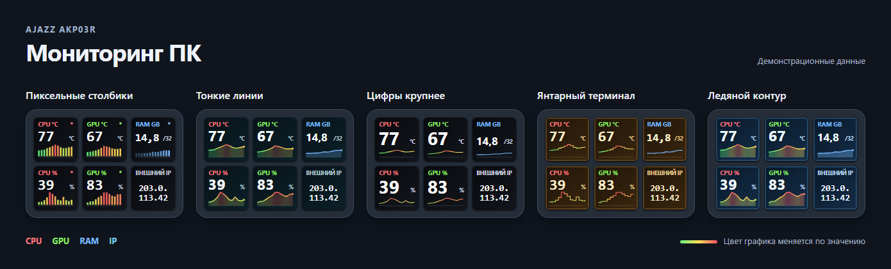
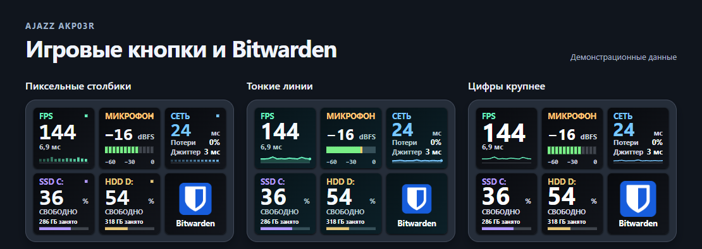

# AJAZZ — ТТХ GPU/CPU/RAM/IP

Мониторинг ПК, игровые кнопки и запуск Bitwarden для AJAZZ Stream Dock. Одиннадцать действий в одной категории с тремя темами.

- **Плагин уже установлен.** Скачай и открой файл, подтверди обновление и полностью перезапусти Stream Dock. [Скачать обновление (.sdPlugin)](https://github.com/Auskraft/ajazz-ttx-gpu-cpu-ram-ip/releases/latest/download/com.auskraft.ajazz.ttx.sdPlugin)
- **Первая установка.** Запусти установщик и подтверди импорт в Stream Dock. [Скачать установщик Windows (.exe)](https://github.com/Auskraft/ajazz-ttx-gpu-cpu-ram-ip/releases/latest/download/AJAZZ-TTX-Setup.exe)

## Установка

1. Установи **Stream Dock AJAZZ Global** версии **3.10.188.226** или новее и запусти программу хотя бы один раз. Нужна 64-битная Windows 10 или 11. Для показаний NVIDIA нужен штатный драйвер с `nvidia-smi`.
2. Скачай и запусти **AJAZZ-TTX-Setup.exe** из [последнего релиза](https://github.com/Auskraft/ajazz-ttx-gpu-cpu-ram-ip/releases/latest). Для всех шести показаний выбери **«Да»** и подтверди запрос Windows. Установщик добавит подписанный драйвер PawnIO, если его ещё нет, и фоновый датчик CPU. AIDA64 не требуется. Если выбрать **«Нет»**, установится плагин с остальными показаниями.
3. Подтверди импорт в Stream Dock. Если категория уже импортирована, но её нет в списке, полностью закрой Stream Dock через область уведомлений и запусти снова.
4. Открой категорию **«ТТХ GPU/CPU/RAM/IP»** и перетащи действия в нужные ячейки.

Для ручной установки плагина из релиза можно открыть `com.auskraft.ajazz.ttx.sdPlugin`. Для температуры CPU по-прежнему нужен фоновый датчик из установщика.

## Настройки кнопок

| Верхний ряд | Температура CPU | Температура GPU | Оперативная память |
| --- | --- | --- | --- |
| **Нижний ряд** | Загрузка CPU | Загрузка GPU | IP-адрес |

- У каждой кнопки можно выбрать **пиксельные столбики**, **тонкие линии** или **крупные цифры**.
- В поле **«Размер цифр»** можно выбрать размер для обычного вида или оставить **«Авто по теме»**. Длинные значения автоматически уменьшаются, чтобы полностью помещаться на экране.
- Нажатие на физическую кнопку показывает **крупное значение**. Повторное нажатие возвращает обычный вид с графиком. Длинный IP может занять несколько строк.
- «Светофор» включается отдельно на каждом графике CPU и GPU. Цвет плавно меняется по значению, а подписи сохраняют цвет компонента.
- В настройках **«Температура GPU»** поле **«Датчик GPU»** переключает температуру ядра и **горячую точку (Hot Spot)**. На экране Hot Spot подписана **GPU HOT**. Если видеокарта или драйвер не отдаёт этот датчик, отображается **—**.
- Цветовые точки для Ryzen 5 5600X — **60 → 75 → 90 °C**. Для ядра RTX 4060 — **50 → 65 → 85 °C**, а для Hot Spot — **65 → 80 → 100 °C**. Для загрузки — **0 → 50 → 100%**.
- Для IP доступны внешний и локальный адрес, фоновое обновление каждые **5** или **15 секунд** и переключатель **«Полоса обновления»**.
- Для внешнего адреса выбери **«Отображение IP» → «Только цифры»** или **«Цифры и флаг по очереди»**. Во втором режиме кнопка сначала показывает адрес, затем флаг и снова адрес. Каждый вид отображается выбранные 5 или 15 секунд. Нажатие показывает крупный адрес.
- В режиме с флагом внешний IP и страна определяются по ответу Cloudflare. При VPN флаг показывает страну выхода в интернет. Если страну определить не удалось, кнопка показывает адрес. Режим «Только цифры» использует `api.ipify.org`, а локальный адрес читается из сетевых интерфейсов Windows. Флаги из [Flagpedia](https://flagpedia.net/download/images) входят в плагин.

Для обновления открой свежий `com.auskraft.ajazz.ttx.sdPlugin` из релиза и перезапусти Stream Dock. Настройки кнопок и установленный датчик CPU сохраняются.

Если браузер добавил к скачанному файлу `(1)` или другой номер, перемести его в отдельную папку и переименуй в `com.auskraft.ajazz.ttx.sdPlugin` перед импортом. Stream Dock ожидает точное имя пакета.

## Игровые кнопки и Bitwarden

| Кнопка | Что показывает или делает |
| --- | --- |
| **FPS и время кадра** | FPS выбранной игры, длительность кадра и график. По умолчанию отслеживает «Мир кораблей» (`Korabli.exe` и `Korabli64.exe`). |
| **Микрофон** | Уровень цифрового сигнала в dBFS и анимированная шкала. Нажатие включает или выключает микрофон Windows по умолчанию. |
| **Сеть** | Пинг, доля потерянных ICMP-запросов и среднее изменение задержки между успешными ответами. Адрес настраивается, по умолчанию `1.1.1.1`. |
| **Место на диске** | Тип накопителя, объём занятого места и процент свободного места на выбранном томе. Для нескольких томов добавь несколько кнопок. |
| **Открыть Bitwarden** | Запускает установленное настольное приложение. Мастер-пароль вводится в Bitwarden, там же можно использовать Windows Hello. |

Пока кнопка микрофона видна, Windows может показывать индикатор использования микрофона. Плагин получает локальный уровень сигнала и состояние выключения. Звук не записывается и не передаётся.

### Доступ к FPS

Intel PresentMon читает события кадров через ETW. Windows предоставляет доступ членам локальной группы **Performance Log Users** («Пользователи журнала производительности»). Если кнопка показывает «Доступ к FPS», запусти игру и открой **Xbox Game Bar → Производительность → FPS → Запросить доступ**, если этот пункт доступен. Затем перезайди в Windows. Администратор ПК также может добавить твою учётную запись в указанную группу. [Требования PresentMon](https://github.com/GameTechDev/PresentMon/tree/v2.5.1#user-access-denied) · [Справка Xbox Game Bar](https://support.xbox.com/en-US/help/friends-social-activity/share-socialize/xbox-game-bar-performance)

Bitwarden — зарегистрированный товарный знак Bitwarden Inc. Кнопка использует [официальный значок приложения](https://github.com/bitwarden/brand/tree/6182cd64321d810c6f6255db08c2a17804d2b724/icons). [Как настроить Windows Hello в Bitwarden](https://bitwarden.com/help/biometrics/)

## Как считываются датчики

Загрузка CPU и память берутся из Windows. Загрузка и температура ядра NVIDIA GPU считываются через `nvidia-smi`. Горячую точку читает включённый в плагин модуль LibreHardwareMonitor через драйвер NVIDIA с обычными правами.
Для температуры CPU установщик создаёт задачу **Auskraft Ajazz TTX CPU Sensor**.
Датчик на базе LibreHardwareMonitor работает в `%ProgramFiles%\Auskraft\AjazzTTX` и сохраняет только температуру и время замера в локальный файл.
Stream Dock читает этот файл с обычными правами. Когда датчик недоступен, кнопка показывает **—**.

Чтобы прекратить фоновый сбор, открой Планировщик заданий и останови и удали задачу **Auskraft Ajazz TTX CPU Sensor**.
После этого можно удалить папку датчика из Program Files. PawnIO может использоваться другими приложениями. Его можно удалить отдельно через установленные приложения Windows, если он больше нигде не нужен.

## Сборка

В PowerShell на 64-битной Windows запусти `.\tools\build.ps1`. Результаты появятся в `dist`.
Сборка проверяет контрольные суммы архивов и цифровую подпись официального установщика PawnIO.
Сторонние лицензии указаны в [заметках к датчику](cpu-sensor/NOTICE.md) и [заметках к PresentMon](fps-sensor/NOTICE.md). Они входят в пакет.
Исходники проекта доступны под [лицензией MIT](LICENSE).
